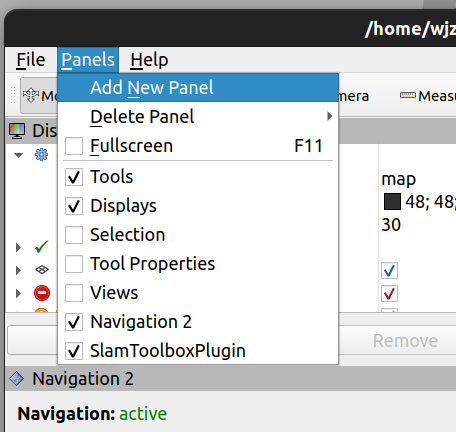
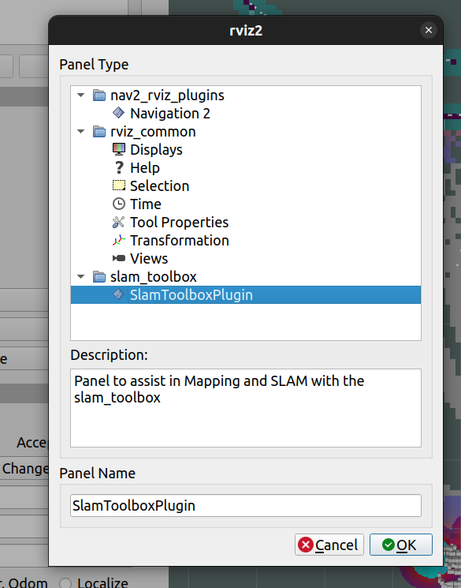
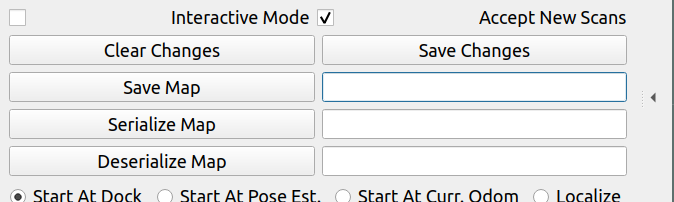

导航程序在 rm_nav_bringup/launch 目录下运行，参数都在 config 目录下（太工那边代码没用launch统一启动程序，而是将各个包的launch都放在了.sh文件中启动，这样会打开一堆终端和rviz，好处是出了问题可以方便定位到哪个包的问题，感觉挺好）
建图就运行`mapping.sh`，主要是为了得到pgm yaml pcd这三个格式文件（用icp的话有这三个就行了），保存这几个文件的话可以按下面来
 

`Save Map`后面框框填你要的文件名字就行，可以保存pgm yaml这两个格式，`Serialize Map`保存posegraph data格式的，保存pcd运行`save_pcd.sh`就行
然后把这几个文件放到`map`和`pcd`目录下编译，然后运行导航程序是把`world`参数改成对应的文件名就行
用amcl定位时得要在启动时在rviz里手动设初始位姿，就之前布置的仿真作业那样  用icp的话就不需要了
和电控通信代码在`decision`包下，话题写的有点多，还有点乱。。。决策代码在`rm_bt`包下，行为树自己会写就行，那些行为树自带的节点运行逻辑都熟了就好，没必要看懂我那些极其繁琐冗余的树。其实可以 把主要的决策逻辑写在注册的插件里，然后在行为树里调用插件就行，要不然就会像这些树一样冗余，在编写和运行的时候都可以用`groot`软件查看效果。可以加入航点，比如统一`1`是哪个点，`2`是哪个点，这样改点的时候也好改一点，树也好写
可以用仿真导出所需要的先验地图，但我觉得还是实际的图跑起来效果更好。仿真导的时候用原代码`pb_rm_simulation`就行，把模型放进`rm_simulation/pb_rm_simulation`里面对应的目录下，然后改里面代码一点点东西再跑仿真就好了