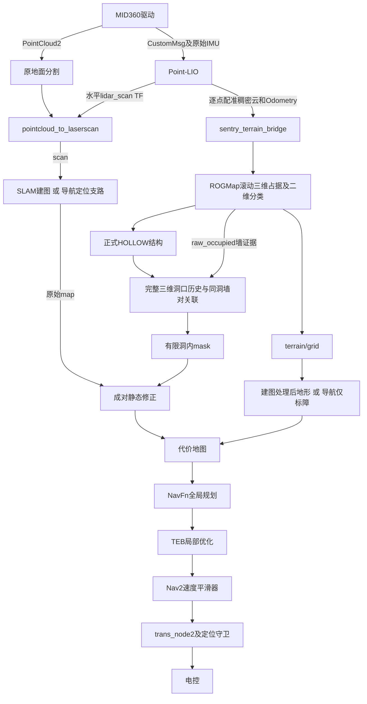
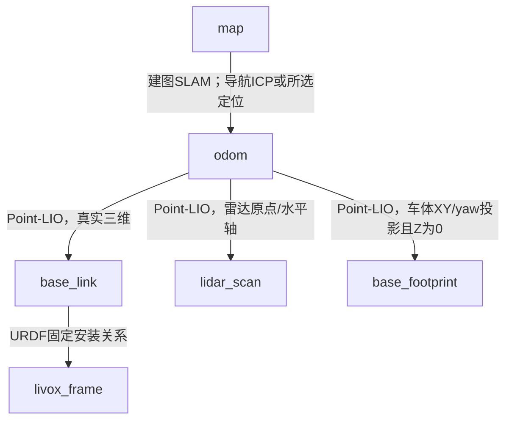

# 从最初ROGMap外接到当前版本：全流程改造回顾

核查日期：2026-11-04。对象：`/home/newmaker-12/zzs_rogMAP` 当前源码、正式配置、启动脚本，以及已有安装清单和回归证据。

这是改造回顾，不是一次新的实车验收。本文没有启动硬件、修改生产代码/参数、重写地图或发送Goal。历史做过、历史安装过、今天源码仍存在、今天现场通过，是四种不同状态。找不到完整原始Git基线时，不会虚构“最初每一行”或把旧文档当当前代码。

## 1. 目标及当前总架构

目标始终是：识别RM场地可通行洞口，在建图中去掉洞内投影假障碍，保留两侧实墙和洞外障碍；把结果保存成能导航的静态底图；导航期间保留底图，并对实时新增障碍绕行。

最初原导航是Livox→LIO、地面分割→二维扫描、SLAM/ICP/AMCL、NavFn/TEB、串口。ROGMap最早只是外接感知支路，后来才逐步增加正式洞口结构、持久记忆、清障和配套保存，不能把这些都说成ROGMap库本身的功能。[最初ROGMap迁移记录](</home/newmaker-12/zzs_rogMAP/docs/ai_refactor_records/20261005_rog_map_perception.md:1>)

这个图展示功能关系，不表示建图和导航同时启用全部分支：建图启用洞口学习和清障；正式导航不再启动记忆学习/清墙。[统一启动与模式分流](</home/newmaker-12/zzs_rogMAP/src/rm_perception/sentry_passage_fusion_test/launch/passage_real.launch.py:107>) [正式记忆与串口节点开关](</home/newmaker-12/zzs_rogMAP/src/rm_perception/sentry_passage_fusion_test/launch/passage_real.launch.py:196>)

## 2. ROGMap到底如何外接

### 2.1 没有把整套开源导航替换进来

- 引入`src/rm_perception/rog_map`作为地图算法库。
- 新增`sentry_terrain_bridge`独立适配节点`terrain_node`，内部创建ROGMap对象，主动调用`updateMap`。
- 原库自己订阅输入被关闭，先验地图/PCD加载关闭，避免两套输入和原静态地图冲突。
- 原SLAM、ICP/AMCL、NavFn、TEB仍有各自职责。
- 没有因为引入ROGMap就换成MINCO/MPC，也没有让ROGMap发布底盘速度或`map→odom`。[独立ROGMap适配节点](</home/newmaker-12/zzs_rogMAP/src/rm_perception/sentry_terrain_bridge/src/terrain_node.cpp:61>) [ROGMap更新及地形/结构发布](</home/newmaker-12/zzs_rogMAP/src/rm_perception/sentry_terrain_bridge/src/terrain_node.cpp:231>)

### 2.2 输入经历过三阶段

1. FAST-LIO可复用已有body点云，适配器明确其数值实际处于IMU系；不能只信写成livox_frame的header。
2. 早期Point-LIO使用已配准但稀疏的world云，避免把未逐点补偿的body云整帧变换后当密集真值。
3. 当前Point-LIO新增独立`/cloud_registered_dense_terrain`：按每点采样时间查询已有滤波轨迹，逐点变换到odom，仅作为地形输入；定位降采样与原world输出独立保留。当前launch明确覆盖输入为odom稠密云。[最初ROGMap迁移记录](</home/newmaker-12/zzs_rogMAP/docs/ai_refactor_records/20261005_rog_map_perception.md:1>) [逐点稠密地形输出](</home/newmaker-12/zzs_rogMAP/src/rm_localization/point_lio/src/laserMapping.cpp:329>) [Point-LIO稠密地形支路接线](</home/newmaker-12/zzs_rogMAP/src/rm_nav_bringup/launch/bringup_real.launch.py:193>)

ROGMap适配还保留`/Odometry`以取得姿态、射线起点和时间关联；点云已经在odom时不能再乘一次整帧雷达外参。[ROGMap更新及地形/结构发布](</home/newmaker-12/zzs_rogMAP/src/rm_perception/sentry_terrain_bridge/src/terrain_node.cpp:231>)

### 2.3 当前主要参数和输出

配置为5cm体素、约10×10×3m滚动窗口，射线更新与占据衰减启用；场地专用剔除框和双雷达偏移不照搬，距离场/ESDF关闭。输出`/terrain/grid`、`/terrain/passage/structure`以及占据调试话题。ROGMap输出局部地形，不等于持久SLAM `/map`。[ROGMap现行配置](</home/newmaker-12/zzs_rogMAP/src/rm_nav_bringup/config/reality/rog_map_real.yaml:24>) [独立ROGMap适配节点](</home/newmaker-12/zzs_rogMAP/src/rm_perception/sentry_terrain_bridge/src/terrain_node.cpp:61>)

另一个容易混淆的点：ROGMap内部占据随新观测更新/衰减，导航底图冻结指的是Nav2的静态地图，不是禁止ROGMap内部滚动或撤销临时占据。

## 3. TF树确实改变了，但谁负责什么必须分清

当前Point-LIO分支的核心树为：

`base_footprint`和`lidar_scan`在当前实现中是`odom`的子节点，与`base_link`并列；不是照搬常见的`odom→base_footprint→base_link`树。URDF固定边仍是`base_link→livox_frame`。ROGMap不负责这些TF。[lidar_scan和base_footprint发布](</home/newmaker-12/zzs_rogMAP/src/rm_localization/point_lio/src/laserMapping.cpp:453>) [URDF安装关系](</home/newmaker-12/zzs_rogMAP/src/rm_nav_bringup/urdf/sentry_robot_real.xacro:11>)

### 3.1 修正IMU、LiDAR和车体的组合关系

历史LIO输出的状态实际以IMU原点为基础，但`/Odometry.child_frame_id`仍叫livox_frame。发布车体TF时不能直接把它当雷达位姿。

当前Point-LIO计算顺序：

`T_odom_base = T_odom_imu × T_imu_lidar × inverse(T_base_lidar)`

内部IMU-LiDAR外参和URDF安装外参都参与，各用一次。FAST-LIO历史也修过对应漏乘内部外参的问题，当前主要实车入口统一Point-LIO。[IMU、雷达与车体位姿组合](</home/newmaker-12/zzs_rogMAP/src/rm_localization/point_lio/src/laserMapping.cpp:399>) [坐标和杆臂速度计算](</home/newmaker-12/zzs_rogMAP/src/rm_localization/point_lio/include/point_lio_frames.hpp:9>)

### 3.2 新增水平扫描坐标系lidar_scan

原点取雷达位置，roll/pitch为0，yaw跟随车体水平朝向；倾斜安装雷达的原点云通过完整TF变换到该坐标系后生成二维scan。它不是把原始点云frame_id改名。

这解决建图/导航一边用倾斜雷达平面、一边用水平扫描的分支不一致问题。当前仍复用原地面分割→pointcloud_to_laserscan链，不用ROGMap伪造scan替代它。[lidar_scan和base_footprint发布](</home/newmaker-12/zzs_rogMAP/src/rm_localization/point_lio/src/laserMapping.cpp:453>) [原始扫描地面分割配置](</home/newmaker-12/zzs_rogMAP/src/rm_nav_bringup/config/reality/segmentation_real.yaml:1>)

### 3.3 新增二维建图基准base_footprint

保留真实base_link的roll/pitch/z，另外取车体XY与yaw并固定Z=0，供Point-LIO建图时的二维SLAM使用。避免二维SLAM为抵消车体倾斜，反向让map→odom带倾斜，进而触发地形投影/记忆的关联保护。

这里Z=0是odom中的二维基准，不代表真实车体中心离地高度为0，也不代表能凭这个TF测量地面高程。Nav2的robot_base_frame当前仍是base_link。[二维SLAM使用base_footprint](</home/newmaker-12/zzs_rogMAP/src/rm_nav_bringup/launch/bringup_real.launch.py:443>) [坐标和杆臂速度计算](</home/newmaker-12/zzs_rogMAP/src/rm_localization/point_lio/include/point_lio_frames.hpp:9>) [当前局部/全局车体轮廓](</home/newmaker-12/zzs_rogMAP/src/rm_nav_bringup/config/reality/nav2_params_rog_map_real.yaml:272>)

### 3.4 两种Odometry分开

- `/Odometry`保留原IMU状态语义，供原感知等消费者使用；旧child命名问题没有通过全工程重命名解决。
- `/navigation/odometry`新增车体中心位姿和base_link轴下速度，用坐标旋转及角速度×杆臂修正，controller_server显式订阅它。

不能把原`/Odometry`中的零twist或IMU速度直接当作真实车体中心速度反馈。[IMU、雷达与车体位姿组合](</home/newmaker-12/zzs_rogMAP/src/rm_localization/point_lio/src/laserMapping.cpp:399>) [坐标和杆臂速度计算](</home/newmaker-12/zzs_rogMAP/src/rm_localization/point_lio/include/point_lio_frames.hpp:9>) [当前TEB及GoalChecker参数](</home/newmaker-12/zzs_rogMAP/src/rm_nav_bringup/config/reality/nav2_params_rog_map_real.yaml:90>)

## 4. 外参、雷达位置与车体几何

### 4.1 已发生的变化

老车副本曾恢复xyz=(0,.17,.25)、RPY=(35°,0°,−180°)。新车先装−Y侧，后改为−X侧；长度/宽度随用户更正，最后确认真实外廓前30、后32、左29、右29cm，高30cm，base_link中心离地11cm。

Z最初填.176，后来用户明确这是雷达原点离地高度，故相对base_link应为.176−.11=.066m。后续重装又做过静态重力方向复核，不能把早期75°、后来口述35°与最后写入值混成同一版本。

### 4.2 今天文件里的值

| 项目 | 当前配置/源码 |
|---|---|
| base_link到雷达xyz | (−.32,0,.066)m |
| 安装RPY | (−.519963467221,.009491641061,1.570796326795)rad，约(−29.792°,.544°,90°) |
| 内部IMU-LiDAR平移 | (−.011,−.02329,.04412)m |
| 内部旋转 | 配置单位阵 |
| 驱动JSON安装外参 | roll/pitch/yaw及xyz全0 |

安装标定、内部标定和驱动预变换是三回事。这份驱动源码确实按JSON旋转IMU，不能说JSON外参“不生效”；置零是为了让实物安装只由URDF表达，避免重复旋转。重力只能约束倾角，不能独立验证yaw和安装位置。当前文件值也不等于实验室精确标定已完成。[当前新车安装外参](</home/newmaker-12/zzs_rogMAP/src/rm_nav_bringup/config/reality/measurement_params_real.yaml:1>) [MID360内部IMU-LiDAR外参及守卫](</home/newmaker-12/zzs_rogMAP/src/rm_nav_bringup/config/reality/pointlio_mid360_real.yaml:40>) [驱动确实旋转IMU](</home/newmaker-12/zzs_rogMAP/src/rm_driver/livox_ros_driver2/src/src/comm/pub_handler.cpp:124>) [驱动JSON外参及IP](</home/newmaker-12/zzs_rogMAP/src/rm_nav_bringup/config/reality/MID360_config.json:14>)

当前JSON主机地址为192.168.1.121，lidar_configs里写192.168.1.3；历史曾实测雷达.145。这是文件现状与历史设备记录的区别，不能把历史IP直接说成当前硬件IP，设备更换时需核对实际传入配置。

### 4.3 当前规划轮廓没有全部统一为实车外廓

- 全局costmap：X=[−.32,.30]、Y=[−.29,.29]，padding=.02。
- 局部costmap和TEB优化轮廓：当前配置约42×38cm，X=[−.22,.20]、Y=[−.19,.19]，局部padding=0。
- 这是用户后续主动缩小轮廓留下的现状，不能继续宣称所有层都严格使用真实62×58cm。

车体尺寸不直接决定ROGMap的HOLLOW列分类；但会影响全局膨胀/可行空间、TEB优化及最终碰撞判定。因此“尺寸不会影响规划”不成立。[当前局部/全局车体轮廓](</home/newmaker-12/zzs_rogMAP/src/rm_nav_bringup/config/reality/nav2_params_rog_map_real.yaml:272>) [当前TEB及GoalChecker参数](</home/newmaker-12/zzs_rogMAP/src/rm_nav_bringup/config/reality/nav2_params_rog_map_real.yaml:90>)

## 5. 从净空检查转向正式洞口结构

早期增加过车体扫掠/净空查询、支撑面和坡面诊断、verified_segment、短时permit、入口gate。它把“识别洞口”与“整个车体净空证明通过”绑在一起，导致大量已观测洞口进不了清障链。后来按用户要求，正式结构输入不再要求净空通过。

现在只有ROGMap原始分类理由为HOLLOW_TUNNEL、raw/current类型都PASSABLE、mask有效且上下端点有限，才输出正式结构列。薄平面PASSABLE、普通自由格不会仅凭可通行就自动变成洞口。净空类旧代码仍存在，可显式打开诊断，但默认不会生成正式清障凭据；不能说相关文件全部物理删除。[正式HOLLOW结构输出条件](</home/newmaker-12/zzs_rogMAP/src/rm_perception/sentry_terrain_bridge/include/sentry_terrain_bridge/hollow_structure.hpp:25>) [Point-LIO稠密地形支路接线](</home/newmaker-12/zzs_rogMAP/src/rm_nav_bringup/launch/bringup_real.launch.py:193>)

“高处薄回波直接判障碍”的额外规则已不在当前列分类路径；当前薄面按高度跨度分类。注意薄面可通行也不等于完整洞口识别成立。[ROGMap列分类源码](</home/newmaker-12/zzs_rogMAP/src/rm_perception/rog_map/src/rog_map/projection_layer.cpp:45>)

## 6. 洞口识别、墙面识别、清障边界是三个步骤

### 6.1 ROGMap先找空心列

原高度差和占据率框架保留：当前薄面跨度上限.25m；原墙分类跨度至少.50m且占据率至少.80；隧道候选跨度.26～.60m且占据率不超过.60。端点有体素浮点容差。

这些是垂直列形态阈值，不是净高认证，也不能声称已经天然得到完整洞体。把surface阈值改.25是后段问题的一轮参数修复，后来误清/漏清重点在关联和有限区域，不能继续靠扩大分类阈值解决。[ROGMap列分类源码](</home/newmaker-12/zzs_rogMAP/src/rm_perception/rog_map/src/rog_map/projection_layer.cpp:45>) [ROGMap现行配置](</home/newmaker-12/zzs_rogMAP/src/rm_nav_bringup/config/reality/rog_map_real.yaml:24>)

### 6.2 再从实测占据结构提取墙

墙面证据使用.26<高度跨度<.60m、占据率≥.80，保留实测支撑点、有限长度、拟合误差与高度端点。这个墙证据规则与ROGMap上面的原墙分类不是一个函数，不要混淆.50与.26两个门限。

墙拟合曾只保留局部约.15m邻域，后来改为沿实测墙支撑延展和同面合并；随后处理了不同高度配墙、斜向错误配对、稀疏源列混入、同洞双侧平行关系。[墙证据高度/占据率约束](</home/newmaker-12/zzs_rogMAP/src/rm_perception/sentry_passage_fusion_test/scripts/wall_observation.py:14>)

### 6.3 最新已经安装的有限分段关联

先有正式HOLLOW分量，再要求墙支撑邻接该分量且高度对应；平行只是必要几何关系之一，不是同洞身份。远处墙不能仅因高度相似被配成本洞一侧。

对长坡洞不再把一个局部墙拟合直线无限延伸到整洞，而沿连续实测双侧墙段分段裁剪；墙只能修剪该洞口有限外包络，不能凭墙对创建洞外大区域。墙端考虑已占据体素半格面积，避免旧短洞后8格又漏清。已准入的墙条带被记忆，用于纠正早期错误清除；这不是把所有实时障碍成本塞进记忆。[先同洞空间邻接再关联墙](</home/newmaker-12/zzs_rogMAP/src/rm_perception/sentry_passage_fusion_test/scripts/roof_association.py:50>) [有限连续墙段裁剪](</home/newmaker-12/zzs_rogMAP/src/rm_perception/sentry_passage_fusion_test/scripts/wall_bounded_region.py:86>) [三维历史与持续清障记忆](</home/newmaker-12/zzs_rogMAP/src/rm_perception/sentry_passage_fusion_test/scripts/continuous_passage_memory.py:200>)

支持多个独立洞口，没有把B/C、A/B、点击坐标或某个洞中心写死。Publish Point只是采样定位与人工验收位置。

最新c2离线验证：原先89个被删静态格中，用户确认A/B共5格是洞内噪声，应清；其余84侧墙格保留，蓝3洞外实物不清。上一短洞后8格仍全部清除。证明这个候选覆盖所验两场景，不是全场零误清或实车自动过洞认证。

## 7. 记忆从二维局部记录变成完整三维历史

早期记录依赖车体扫掠/局部二维结果。后来保留source_frame、分辨率、完整三维列上下端点、观测对应完整三维变换，按源与世界几何去重合并；投影到map后形成持久清障区域。

解决过：滚动窗口移走就丢失洞口；新观测替换历史；扩图后画布变化导致挂起；同尺寸原点微移失配；记录过多超过4MB限制；文件写盘错误只有笼统状态。

现在扩图/允许的小原点变化基于世界区域重投影，历史三维组不随画布裁掉；矩形仅对相同Y边界、相交或相接X区间无损压缩，保持正间隙，不靠加epsilon黏连扩大清障。文件仍校验、原子写入并保留旧策略备份。

当前`continuous_v4`是记录模型版本，`finite_segmented_roof_v3`是清障策略版本，两者不是同一版本号。旧不合格清障区域不盲继承，完整三维历史保留后按新规则审核。[三维历史与持续清障记忆](</home/newmaker-12/zzs_rogMAP/src/rm_perception/sentry_passage_fusion_test/scripts/continuous_passage_memory.py:200>) [结构墙条带保存与策略迁移](</home/newmaker-12/zzs_rogMAP/src/rm_perception/sentry_passage_fusion_test/scripts/continuous_passage_memory.py:231>)

失效保护仍在：新建图会话、地图重载、TF/定位关联失效、写盘失败等不能强行冒用旧结果。因此“永不回堵”不是当前承诺；真正关联失效时允许撤销修正。

## 8. 为什么之前清了还会回来，分别修了什么

| 已定位的回堵/闪烁机制 | 对应处理 |
|---|---|
| 滚动窗口移走、当前观测覆盖旧结果 | 完整三维历史与累计世界区域 |
| 扩图先到原图、后到mask | PairedStaticLayer成对交接，不把旧mask套新画布 |
| 同一帧地形先清除后又原样回发 | MappingTerrainOutput缓存，同源保持处理结果，不刷新原时间戳 |
| 实时地形障碍覆盖静态清除 | 建图专用mapping_terrain，确认洞内按用户策略强制清除 |
| 输出异常提前return，墙证据更新被跳过 | 输出与墙更新拆开，异常不阻断独立墙更新 |
| 二维建图用倾斜base造成map→odom倾斜 | 新base_footprint供二维建图 |
| 真TF/定位失效、证据超时 | 保留撤销/等待，不靠假时间戳或强绑历史掩盖 |

这几类不是同一处bug，不能用“以前修过清障范围”覆盖后续所有原因。[原图和mask成对交接](</home/newmaker-12/zzs_rogMAP/src/rm_perception/sentry_terrain_bridge/src/paired_static_layer.cpp:35>) [地形清除与同源输出缓存](</home/newmaker-12/zzs_rogMAP/src/rm_perception/sentry_passage_fusion_test/scripts/mapping_terrain.py:38>) [地形输出异常不跳过墙更新](</home/newmaker-12/zzs_rogMAP/src/rm_perception/sentry_passage_fusion_test/scripts/live_memory_shadow.py:642>) [二维SLAM使用base_footprint](</home/newmaker-12/zzs_rogMAP/src/rm_nav_bringup/launch/bringup_real.launch.py:443>)

建图模式按用户后来的明确要求，对**已通过同洞边界审核的内部**强制清除，实时地形标占据不再逐格否决；不能把这扩展成全场自由格均可清或导航也忽略洞内新障碍。[三维历史与持续清障记忆](</home/newmaker-12/zzs_rogMAP/src/rm_perception/sentry_passage_fusion_test/scripts/continuous_passage_memory.py:200>) [地形清除与同源输出缓存](</home/newmaker-12/zzs_rogMAP/src/rm_perception/sentry_passage_fusion_test/scripts/mapping_terrain.py:38>)

## 9. /map、修正图、地形图和代价地图的关系

- `/map`：SLAM原始二维地图；感知不反向写SLAM内部概率。
- `/terrain/grid`：ROGMap滚动地形，在odom。
- `/terrain/passage/structure`：正式空心列，保留上下端点。
- `/passage/verified_static_clearing`：map系静态清障mask；名字含verified不意味着重新加回车体净空证明。
- `/passage/static_correction_source`：与mask配套的原图快照。
- `/passage/static_corrected_map`：原图副本应用已确认mask后的静态修正图。
- `/passage/mapping_terrain`：建图时去掉确认洞内回波投影的地形输出。
- `/global_costmap/costmap`与`/local_costmap/costmap`：供规划与控制使用的合成地图，包含插件叠加/膨胀。

现在RViz建图默认Map被替换为static_corrected_map，原map作为关闭的debug显示保留。这解释“RViz看map清了”的一部分语义：看见修正图不等于SLAM原始/map已被改。[建图RViz话题替换](</home/newmaker-12/zzs_rogMAP/src/rm_perception/sentry_passage_fusion_test/launch/passage_real.launch.py:77>) [仅修正静态100格的共享快照](</home/newmaker-12/zzs_rogMAP/src/rm_perception/sentry_passage_fusion_test/scripts/paired_grid.py:37>)

NavFn按全局代价地图规划，TEB主要消费局部代价地图和全局参考路径；不是直接在PGM像素或原/map上画线。修改底图会影响输入，但最终路径还受实时地形、膨胀、未知格、轮廓和局部碰撞检查影响。[当前TEB优化使用点障碍](</home/newmaker-12/zzs_rogMAP/src/rm_navigation/teb_local_planner/teb_local_planner/src/teb_local_planner_ros.cpp:513>) [当前NavFn配置](</home/newmaker-12/zzs_rogMAP/src/rm_nav_bringup/config/reality/nav2_params_rog_map_real.yaml:396>)

## 10. 建图和导航现在严格分工     

### 建图入口

`mapping.sh`进入`passage_real.launch.py mode=mapping lio=pointlio enable_motion=false`。原扫描建立/map；洞口记忆输出mask及修正地图；全局静态层使用PairedStaticLayer；地形层改吃mapping_terrain，最后原膨胀层处理。默认不启动串口，因此可以看Nav2 Goal规划而不驱动车。[建图/导航的实际代价图接线](</home/newmaker-12/zzs_rogMAP/src/rm_perception/sentry_passage_fusion_test/launch/passage_real.launch.py:135>) [正式记忆与串口节点开关](</home/newmaker-12/zzs_rogMAP/src/rm_perception/sentry_passage_fusion_test/launch/passage_real.launch.py:196>)

### 导航入口

`nav.sh MAP /dev/ttyACM0`先校验选定地图与配套文件，再初始化串口和启动Point-LIO/所选定位。全局和局部都加载普通StaticLayer选定/map；不启洞口记忆/probe/gate学习清墙；地形为marking_only，只叠加障碍；当前源观测撤走后撤销自身叠加，不擦静态底图。[建图/导航的实际代价图接线](</home/newmaker-12/zzs_rogMAP/src/rm_perception/sentry_passage_fusion_test/launch/passage_real.launch.py:135>) [地形层marking_only和最大代价叠加](</home/newmaker-12/zzs_rogMAP/src/rm_perception/sentry_terrain_bridge/src/terrain_layer.cpp:215>)

因此加载`testl7`就是`testl7.yaml`对应图，不自动改加载`testl7_nav`。后续保存的新正常名本身是审核后的修正静态图，`NAME_raw`另存原始档案；不要把“导航保持选定底图”误读成“导航必须强制加载_raw”或“导航继续自动开洞”。

YAML里还留着旧obstacle_layer/stvl段，并不表示插件列表启用了它们。正式启动会生成临时YAML并按mode覆盖插件列表，核查运行行为不能只看一段enabled:true。[建图/导航的实际代价图接线](</home/newmaker-12/zzs_rogMAP/src/rm_perception/sentry_passage_fusion_test/launch/passage_real.launch.py:135>)

## 11. 保存不再是孤立存一张PGM

`save_passage_map.sh NAME`调用export_pointlio_map。当前导出包括：

- `NAME.yaml/pgm`：修正静态图；
- `NAME_raw.yaml/pgm`：原SLAM档案；
- `NAME.posegraph/.data`：SLAM序列化；
- 同名map系PCD；
- `NAME.registration.json`：文件哈希、坐标关联、清障快照信息。

原图与mask必须匹配几何/内容指纹、会话和时间；只对静态100格写0，不把实时障碍、膨胀圈或全局costmap存成静态底图。通过选定/map时刻的完整map←odom变换导出PCD，防止二维图和PCD不同系。阶段目录先完成导出，再发布最终文件，失败撤回本次新文件，不覆盖旧地图；同步源码及安装资源目录，防止保存了却启动找不到。[地图成套导出事务](</home/newmaker-12/zzs_rogMAP/src/rm_perception/sentry_passage_fusion_test/scripts/export_pointlio_map.py:178>) [仅修正静态100格的共享快照](</home/newmaker-12/zzs_rogMAP/src/rm_perception/sentry_passage_fusion_test/scripts/paired_grid.py:37>) [地图文件身份校验](</home/newmaker-12/zzs_rogMAP/src/rm_perception/sentry_passage_fusion_test/launch/passage_real.launch.py:23>)

修过map_saver QoS/等待：在独立话题持续发布冻结快照，transient_local订阅、显式超时，避免只发一次对方还没订阅；旧报错“必须有measured passage status”现在会输出实际状态及写盘原因。新导出`free_thresh=.196`用于保持未知灰度加载语义，旧地图不因此被自动改写。[冻结地图保存器的QoS及超时](</home/newmaker-12/zzs_rogMAP/src/rm_perception/sentry_passage_fusion_test/scripts/export_pointlio_map.py:146>) [地图成套导出事务](</home/newmaker-12/zzs_rogMAP/src/rm_perception/sentry_passage_fusion_test/scripts/export_pointlio_map.py:178>)

限制：PCD历史截止服务时可能晚于选定二维图时刻；使用单个map←odom关联，不等于SLAM回环后逐关键帧点云全部优化。不能称整包每个点都与最终位姿图精确绑定。

## 12. 全局规划NavFn改过什么

正式工程新增Nav2 1.1.20来源的本地nav2_navfn_planner覆盖包，没有改系统/opt/ros/humble。

核心补丁是负方向跨格时，dx/dy小于0即换到相邻格并归一化，代替旧负到−1才换格；使双线性梯度使用当前位置对应格。没有把Dijkstra换A*，当前use_astar=false、allow_unknown=true、planner tolerance=1m。[NavFn负向跨格修复](</home/newmaker-12/zzs_rogMAP/src/rm_navigation/nav2_navfn_planner/src/navfn.cpp:898>) [当前NavFn配置](</home/newmaker-12/zzs_rogMAP/src/rm_nav_bringup/config/reality/nav2_params_rog_map_real.yaml:396>)

这修正路径提取局部回折/偏移，不保证整车可行，不等于TEB计算超时、跟踪偏侧、到点停车全部修复。路径存在、沿双侧墙间通过、真实车体无碰、实车按路线行走，是不同验收层级。

## 13. TEB做过很多试验，当前必须按源码分辨

历史开展过有符号距离、障碍格外接圆、真实面积碰撞、终点yaw容差/局部朝向候选、20cm到达区内部终点、重采样时间和性能对照。也做过nuc12/nuc13组合安装与回放。不能把所有试验同时列成当前功能。

本次核对当前文件得到：

1. 控制器仍是TEB，40Hz，未切换PB PID；translation_only=true，每轮跟随实测车体yaw，只优化平移/时间，输出wz=0。适用于用户全向底盘，目标箭头不会强制该分支转向。
2. 开着goal_approach：用到完整全局终点的距离压输出合成平移速度上限，距离1m、最大1m/s。它是输出限幅，不是完整提前制动、真实停稳或平滑器状态联动。
3. 最终可行性检查参数目前为−1/−1.0，覆盖完整局部轨迹；用户曾改为1/1.0，不应继续把旧值当现行值。
4. 当前优化障碍入口仍构造PointObstacle；最终isPoseValid调用DWB ObstacleFootprintCritic::scorePose。历史的“格外接圆”和“真实格面积统一判定”不能声称此刻仍启用。
5. 历史组合安装清单包含goal_heading.h，但当前该路径文件不存在，当前控制器也没有那套终点区域调用。说明历史安装快照和今天树不完全一致；本次未追定是谁/何时替换，也未擅自恢复。

这项差异必须公开，而不是用过期记录把当前TEB包装成所有候选的集合。当前源码与当时隔离成果的映射，后续需单独核查。[当前TEB及GoalChecker参数](</home/newmaker-12/zzs_rogMAP/src/rm_nav_bringup/config/reality/nav2_params_rog_map_real.yaml:90>) [当前TEB只平移模式](</home/newmaker-12/zzs_rogMAP/src/rm_navigation/teb_local_planner/teb_local_planner/src/teb_local_planner_ros.cpp:324>) [TEB最终目标减速](</home/newmaker-12/zzs_rogMAP/src/rm_navigation/teb_local_planner/teb_local_planner/src/teb_local_planner_ros.cpp:449>) [局部轨迹检查与拒绝日志](</home/newmaker-12/zzs_rogMAP/src/rm_navigation/teb_local_planner/teb_local_planner/src/optimal_planner.cpp:1660>) [当前TEB优化使用点障碍](</home/newmaker-12/zzs_rogMAP/src/rm_navigation/teb_local_planner/teb_local_planner/src/teb_local_planner_ros.cpp:513>) [当前TEB最终调用DWB检查](</home/newmaker-12/zzs_rogMAP/src/rm_navigation/teb_local_planner/teb_local_planner/src/optimal_planner.cpp:1733>)

PB PID及配置空间参考线、完整平滑过渡+刹停审核做过隔离实验；nuc12部分条件改善，但nuc13可靠通道和联合整车出洞不通过，未替换正式控制器。TDT/HERO/北理/PB等开源阅读与对照不等于整套代码已经采用；实际ROGMap本地迁移来源见最初记录，不冒认未取得的MPC实现。

## 14. 当前速度链、慢速和过冲还剩什么

实际速度出口：`TEB/controller → /cmd_vel_nav → velocity_smoother → /passage/nav_cmd_vel → trans_node2 → UART`。`/passage/chassis_cmd_vel`是旧gate/IO诊断出口，看到它为0不能认定实际串口没有速度。[控制器和平滑器输出重映射](</home/newmaker-12/zzs_rogMAP/src/rm_navigation/rm_navigation/launch/navigation_launch.py:121>) [正式记忆与串口节点开关](</home/newmaker-12/zzs_rogMAP/src/rm_perception/sentry_passage_fusion_test/launch/passage_real.launch.py:196>)

当前参数：TEB x前后1m/s、y2.5m/s、theta1.8rad/s；平滑器各轴上限±1、40Hz、OPEN_LOOP、XY加速1.8/减速1.8，角减速6；translation_only时旋转输出另被置0。配置限速不等于实车已标定速度。[当前TEB及GoalChecker参数](</home/newmaker-12/zzs_rogMAP/src/rm_nav_bringup/config/reality/nav2_params_rog_map_real.yaml:90>) [当前速度平滑器配置](</home/newmaker-12/zzs_rogMAP/src/rm_nav_bringup/config/reality/nav2_params_rog_map_real.yaml:431>)

当前GoalChecker仍是SimpleGoalChecker，XY=.20m、yaw=6.28、stateful=true；没有因为讨论过StoppedGoalChecker就真的切换。末段减速存在，但“到达区域时仍高速”“平滑后速度滞后”“发0后底盘实际响应”这三件事尚未形成完整生产修复。过去包中TX在Goal终态后很快归0，也纠正了“smooth残留全都继续发到电控”的早先推断。

不能说TEB数学输出方向对就实车一定跟线；也不能在缺电控闭环源码、外部标尺标定时直接乘.5或翻转vy。历史独立原始点云配准支持位移确有执行响应失配的迹象，但不足以直接指认MCU某一行错误。

## 15. 串口从sen_xin迁移并加入什么

复用用户指定trans_node2；init_serial.sh做设备/权限等初始化，nav.sh默认/dev/ttyACM0且检查设备占用。协议仍30字节：0xA5、命令9，三float32按原字段直接装vx/vy/wz，后续姿态/就绪/超电等字段保留，10ms发送周期。没有在传输层自行加速度倍率/换轴。[串口30字节原速度载荷](</home/newmaker-12/zzs_rogMAP/src/decision/src/trans_node2.cpp:430>) [串口命令和定位守卫](</home/newmaker-12/zzs_rogMAP/src/decision/src/trans_node2.cpp:531>)

新增有限命令超时、odom新鲜度、定位状态/代次与motion_ready检查；坏值或不满足条件时发零。原gate permit不再串在正式Nav2→串口主路径，但定位守卫没有删除。[正式记忆与串口节点开关](</home/newmaker-12/zzs_rogMAP/src/rm_perception/sentry_passage_fusion_test/launch/passage_real.launch.py:196>) [串口命令和定位守卫](</home/newmaker-12/zzs_rogMAP/src/decision/src/trans_node2.cpp:531>) [定位代次与旧Goal撤销](</home/newmaker-12/zzs_rogMAP/src/rm_perception/sentry_passage_fusion_test/scripts/localization_health.py:63>)

/passage/serial_tx_status输出实际尝试帧速度、write返回字节数、写入结果和blocking_reason。write_complete只表示库接收完整30字节，不是电控ACK；曾以为仅话题有速度即可证明电控收到，是证据层级不够。[实际写入观测](</home/newmaker-12/zzs_rogMAP/src/decision/src/trans_node2.cpp:398>)

11月3日串口持续0的一次实际原因是Runtime IO被全局padding=2m参数拒绝退出，motion_ready缺失；已经只把该padding修为.02并编译。不能把那次零速归串口接线失败或私自绕守卫。

## 16. Point-LIO乱飞、断流和失效处理的变化

增加输入时间/跨度、非有限状态、预测步长、有效激光约束等检查；过滤失败/异常时停止坏状态写地图和输出，保留节点及洞口历史，通过现有状态话题让导航停车并取消旧Goal。对旧Goal按UUID撤销，恢复健康后也要求新Goal，不把迟到cancel落到新Goal。

早期修复曾把初始化/异常与退出整链绑定，用户指出后已修正：初始化坏输入重新收集，墙钟超时先降级，不直接当真实样本缺口永久锁定；真实时间回退、样本大缺口、不可恢复滤波失效仍NEEDS_RESET。节点活着不等于它还在输出定位；自动重置滤波并续接旧地图没有实现。[Point-LIO输入故障分级](</home/newmaker-12/zzs_rogMAP/src/rm_localization/point_lio/include/point_lio_input_guard.hpp:20>) [定位代次与旧Goal撤销](</home/newmaker-12/zzs_rogMAP/src/rm_perception/sentry_passage_fusion_test/scripts/localization_health.py:63>)

驱动同时修过未同步时钟使用单调epoch、首批组帧边界与逐点相对时间越界/下溢，避免坏offset变成数秒扫描。不是随意把旧消息时间改成现在掩盖延迟。[驱动时间与逐点相对时间策略](</home/newmaker-12/zzs_rogMAP/src/rm_driver/livox_ros_driver2/src/src/comm/timestamp_policy.h:6>) [CustomMsg相对时间检查](</home/newmaker-12/zzs_rogMAP/src/rm_driver/livox_ros_driver2/src/src/lddc.cpp:327>)

11月4日最新问题：原始LiDAR1726帧无header大缺口，但Point-LIO报消费戳缺口并锁；下游lidar_scan TF停止后才queue full。已正式安装LiDAR KEEP_LAST5→20与缺口前后戳诊断，17项守卫测试、全包5组30项正式回归通过。短暂1.2s积压在原生DDS对照中改善；真实1s源缺口和超20帧积压仍锁。不能把这说成持续过载根因已解决。[20帧LiDAR缓存](</home/newmaker-12/zzs_rogMAP/src/rm_localization/point_lio/src/laserMapping.cpp:548>) [缺口前后时间戳诊断](</home/newmaker-12/zzs_rogMAP/src/rm_localization/point_lio/src/laserMapping.cpp:633>)

网口物理Down/Up在nuc14和10月31日确实记录过，属于独立证据；11月4日这一轮未录到同类Link Down，不能继续把所有异常一概归网线，也不能仅凭没有Link Down保证UDP完全无丢包。

## 17. 定位与建图统一改造

mapping/nav现在统一Point-LIO及水平扫描，修正之前FAST-LIO建test1、Point-LIO导航的混用。ICP支持RViz base_link初值的真实坐标转换，配置粗体素由2m改.4m，精体素.1m、评分阈值.1保留；yaw搜索扩至±180°/30°步进，XY范围.2m。AMCL也试验过，但没有将默认nav.sh切到AMCL。[统一启动与模式分流](</home/newmaker-12/zzs_rogMAP/src/rm_perception/sentry_passage_fusion_test/launch/passage_real.launch.py:107>) [当前ICP粗精配准和搜索参数](</home/newmaker-12/zzs_rogMAP/src/rm_nav_bringup/config/reality/icp_registration_real.yaml:1>)

/map→odom由建图SLAM或导航指定定位源提供，ROGMap没有接管。ICP成功、Point-LIO TRACKING、地图点云实际对齐三者分别检验，不能拿一次accepted代替后续定位持续健康。

## 18. 工程辅助、仿真和临时实验

- 补serial源码依赖、G2O接口/查找兼容、曾处理TEB包目录移动后的CMake旧缓存。build.sh当前仍是colcon build --symlink-install，不代表以往单包通过就所有时刻全量通过。
- 新增record_navigation_check.sh，收原始输入、TF、LIO状态、局部/全局地图、计划、控制器/平滑/实际TX等；新旧录包缺失话题不同，不能用没有录到推断节点没发布。[完整检查录包脚本](</home/newmaker-12/zzs_rogMAP/record_navigation_check.sh:24>)
- 仿真增加sentry_passage_sim与独立导航入口，单独构建/安装目录、隔离ROS域、无实车驱动/串口；导航仿真用真值位姿隔离感知/规划问题，不是证明Point-LIO真实断流自动恢复。[隔离导航仿真入口](</home/newmaker-12/zzs_rogMAP/run_passage_navigation_sim.sh:1>)
- zzz开机单点实验放在本学习目录的temporary_nav_zzz，不在工作空间src。保留run/one_goal/show_logs/uninstall等，至少等10秒并等定位/action就绪才发一次目标(1.025,−1.675)，服务不循环重启；另有桌面日志终端。旧自瞄watchdog清理属于主机启动管理，不能混进导航算法清障修改。本次只核对文件，没有声称服务当前enabled/active，也未启停它。
- zzs_rogmap_old是老车副本，安装外参保留35/0/−180°与老平移，不是跟随新车工作空间自动同步的镜像；当前新改动不能默认说老车也已安装。

## 19. 主要阶段及结果边界

| 阶段 | 做过的主要事情 | 今天应怎样理解 |
|---|---|---|
| 最初迁移 | ROGMap库、独立bridge、TerrainLayer、感知切换 | 外接感知架构仍是基础 |
| 10月19—20前后 | 坐标问题、净空/坡面诊断、影子记忆 | 净空后来退出正式准入，旧文件仍在 |
| 10月21换车 | 外参、尺寸、JSON预旋转、老车副本、依赖 | 当前值以最新配置为准 |
| 10月22 | Point-LIO逐点稠密地形、连续三维历史、扩图保持 | 现役；不是改LIO定位点密度 |
| 10月23 | 串口导航入口、统一Point-LIO、水平扫描、成套保存、ICP搜索 | 现役主入口基础 |
| 10月24—25 | 驱动时间/初始化回归、定位失效停车和旧Goal撤销 | 后续又改墙钟超时分级；真断流仍锁 |
| 10月25—29 | TEB多候选、时间/几何/Goal对照、NavFn跨格修复 | 多数只能按具体候选记录评价，NavFn两行修复明确仍在 |
| 10月30 | nuc12/nuc13组合安装、PB PID联合审核 | 部分历史TEB源码与今天不一致；PB没有成为正式控制器 |
| 10月31 | 自主偏侧/过冲分析、真实TX观测、独立点云速度复核、物理链路断连 | 观测已装；整体制动/底盘响应未闭环修复 |
| 11月1—2 | 重装倾角复核、隔离仿真、静态快照、扩图成对交接 | 原map与修正map语义逐步明确 |
| 11月3 | 无损记忆压缩、显示保存一致、有限洞体/墙对、独立墙更新、水平base | 已安装；长坡场景又暴露外推误清 |
| 11月4 | c2分段保墙、空间邻接拒绝远墙、5格噪声身份确认 | 7文件已装，13组正式测试过，实车联合验收未完成 |
| 11月4最新 | LiDAR缓存20、缺口诊断 | 3文件已装，5组30项正式回归过，待新启动验证 |

## 20. 当前最重要的未完成项

1. 最新定位缓存修复后，静止/移动/持续负载下的输入、TF、scan连续性尚未现场验收；持续过载责任点未唯一定位。
2. c2长坡洞要联合验证前中后清通、真实侧墙保留、穿洞后保持、多洞互不串联、保存重载一致；离线5噪声与84侧墙正确不等于全场保证。
3. 全局真实轮廓与局部/TEB缩小轮廓的现状必须明确，不能靠缩车结果宣称真实整车无碰。
4. TEB历史候选、安装清单与当前源码存在差异，需单独整理，不能叠加宣称功能。
5. 实车偏侧、发送速度与实际运动响应、到点停稳/过冲没有完整闭环修复；SimpleGoalChecker、OPEN_LOOP smoother仍现役。
6. 当前仍保留旧净空/probe/gate/注释和实验文件，增加理解成本；正式入口大部分已绕开，但本次未擅自删除。旧文档明确只作历史，不当今天参数真值。

下一轮仍围绕“可靠过洞”顺序：定位持续有效→洞体识别和边界→清障及保存→全局过洞线→局部整车可行→实际速度/轨迹→整车出洞并停稳。不要因为中间某一层通过就跳过后面的结果验收。
